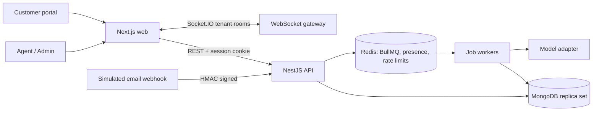

# HelpHarbor

**A multi-tenant support desk with an SLA engine and cited reply drafts.** HelpHarbor gives small software teams one shared queue where every ticket carries a deterministic SLA clock, agents can see when someone else is already replying, and suggested replies are built only from the team's own published knowledge-base articles.

> **Status:** early development, following a 7-week roadmap (see below). No application code yet. The project uses only synthetic companies, customers and tickets; inbound email is a simulated, signed webhook.

## The problem

Small support teams working from a shared inbox run into the same issues:

- two agents reply to the same customer
- urgent tickets miss their response-time promise without anyone noticing
- answers drift away from the documented policy

## Who it's for

- **Workspace admins:** configure SLA policies, business hours and the knowledge base
- **Team leads:** reassign work and review metrics
- **Agents:** work the queue and reply to customers
- **Customers:** submit tickets by email or web form and see public replies only

## Demo workflow

1. A simulated email arrives for the tenant "Acme Cloud" and becomes a ticket with a 4-business-hour first-response SLA
2. Suggested triage proposes category "billing" and priority "high"; the agent confirms
3. The agent opens the draft panel and sees a reply citing two knowledge-base articles
4. A second agent opens the same ticket and sees "Ana is replying"
5. Ana edits and sends; the first-response clock stops
6. The customer replies, the ticket reopens, and the team lead sees it in the breach-risk view

## Planned features

- Workspaces, invitations and roles with strict tenant isolation
- Idempotent inbound message ingestion with threading
- Ticket queue with saved views, cursor pagination and realtime updates
- Ticket detail with public replies, internal notes and an audited timeline
- SLA engine that pauses and resumes by business hours, holidays and "waiting on customer"
- Live "viewing" and "replying" indicators with collision-safe sends
- Macros with server-side variable rendering
- Knowledge base with draft → review → published versions
- Suggested triage (category, language, priority) that an agent must confirm
- Reply drafts citing published articles, never sent automatically
- Customer portal, reports and a knowledge-base gap report

## Tech stack

| Layer | Technology |
|---|---|
| Frontend | Next.js (App Router), React, TypeScript |
| API | NestJS REST API + WebSocket gateway (Socket.IO) |
| Background jobs | NestJS workers on BullMQ |
| Database | MongoDB replica set with Search and Vector Search |
| Cache and queues | Redis |
| Shared contracts | Zod |
| Local environment | Docker Compose |
| CI | GitHub Actions |

## Architecture

Next.js renders the UI only and talks to the NestJS API with the user's session; it never connects to MongoDB, so authorization lives in one place. NestJS owns authentication, tenancy and every write. The SLA engine is a pure TypeScript package shared by the API and the workers. Workers handle ingestion, SLA breach checks, embeddings and model calls, so no model call happens inside an HTTP request.



### Planned repository layout

```text
helpharbor/
├── apps/web/              # Next.js: agent console, admin, customer portal
├── apps/api/              # NestJS: REST, WebSocket gateway, domain modules
├── workers/jobs/          # BullMQ processors
├── packages/contracts/    # shared Zod schemas
├── packages/sla-engine/   # pure business-hours clock with golden tests
├── packages/ui/           # shared React components
├── infra/                 # Compose, monitoring
├── tests/                 # end-to-end, contract and load tests
└── docs/                  # architecture decisions, SLA policy, runbooks
```

## Design rules

- Every query is scoped by the tenant from the session, never from the request body.
- Replaying the same inbound message produces exactly one ticket message.
- SLA due times are deterministic and covered by golden tests across business hours, holidays and DST.
- Suggestions and drafts are never sent automatically; a human sender is always recorded.
- Customers never see internal notes or drafts.

## Roadmap

| Week | Focus | Status |
|---|---|---|
| Week 1 | **Product definition & workspace bootstrap** — Add product charter, ADR 0001 and Next.js workspace shell, bootstrap NestJS API, Compose stack and shared contracts | Planned |
| Week 2 | **Tenancy, auth & ticket ingestion** — Add tenants, session login and tenant-scoped guards, add tickets, messages and signed idempotent inbound webhook, add ticket queue and conversation view with synthetic seed | Planned |
| Week 3 | **Replies, audit & SLA engine** — Add replies, notes, status machine and audited assignment, add macros and cover reply conflicts and invalid transitions, add pure business-hours SLA engine with golden fixtures, add SLA badges, calendar editor and breach-check job | Planned |
| Week 4 | **Realtime presence & collision detection** — Add authenticated Socket.IO gateway with Redis presence, add outbox relay, live queue and replying banner | Planned |
| Week 5 | **Knowledge base, triage suggestions & staging** — Add versioned articles, editor and triage suggestion job, add triage suggestion review with failure-case tests, add retries, dead-letter queue, status API and structured logs, provision staging environment with runbook | Planned |
| Week 6 | **Cited reply drafts, reports & KB gaps** — Add article embeddings, hybrid retrieval and cited reply drafts, add SLA aggregations, daily rollups and KB gap report, add reports dashboard and safe CSV export | Planned |
| Week 7 | **Hardening & release** — Audit tenant and role checks, add rate limits and tracing, run input abuse suite and rehearse backup restore, tag release candidate with demo seed and changelog, deploy public demo with monitoring | Planned |

## Getting started

Setup instructions will be added once the first services are in place.
